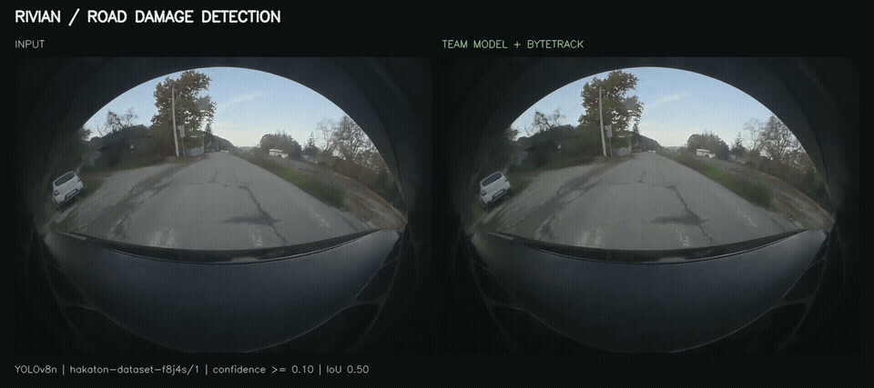

# Rivian road-damage demo

[Watch the MP4 comparison](rivian-demo.mp4)

This 15-second clip was processed through the real `POST /upload-video/` endpoint with `model=custom`, using **YOLOv8n `hakaton-dataset-f8j4s/1`**, the uploaded team model from November 15, 2025. Roboflow hosted inference supplies the predictions; this backend runs Supervision ByteTrack, box/label annotation, GPS association and SQLite persistence. No detections were manually drawn or synthesized.

## Source and settings

- Local source: `RivianAutoVision2025/Rivian Dash Cam - Long Drive Session/9/11_13_25_154945_frontCenter_001.mp4`.
- Excerpt: **02:10–02:25**, original 1376 × 976 at 30 FPS, 450 frames; no audio.
- All source frames are processed. Model confidence threshold: **0.10**; IoU threshold: **0.50**, matching the existing application.
- Original frontCenter GPS samples 3900–4349 are used locally under the backend's 30 Hz assumption. GPS coordinates and the database are not included in the demo files.
- MP4 presentation: input on the left, annotated output on the right. Panels are resized for presentation after inference. The GIF shows seconds 2–10 of the MP4 at 8 FPS.

## Observed result

The pipeline produced **5 unique tracker IDs**. Final stored classes per track: `{"alligator cracking": 5}`. A tracker ID is not a verified unique road defect; tracking can fragment, and predictions can be wrong. The database keeps the latest accepted observation per track.

This is a qualitative demonstration, not a labeled evaluation. The source contains cracks, patches and other road features. Some patches/markings may be labeled as potholes, low-confidence predictions are present, and some damage is missed. The low confidence threshold is inherited from the prototype. Model performance and geographic alignment require separate validation.

See [result.json](result.json) for processing details and the root README for running hosted inference. Model weights and API credentials are not included.
