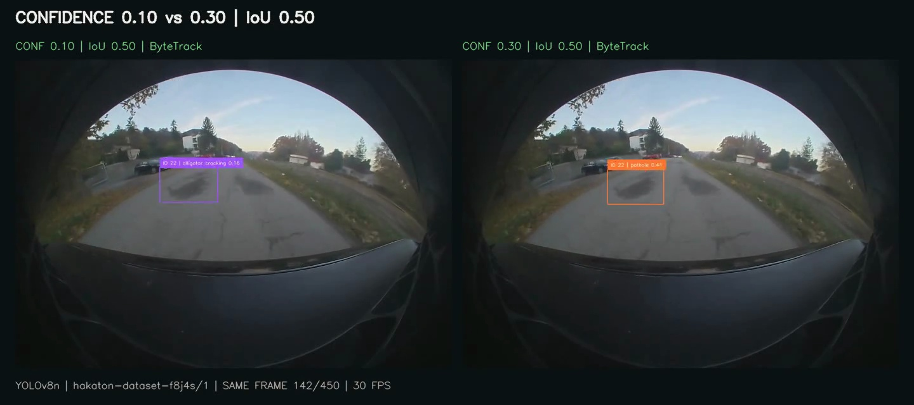
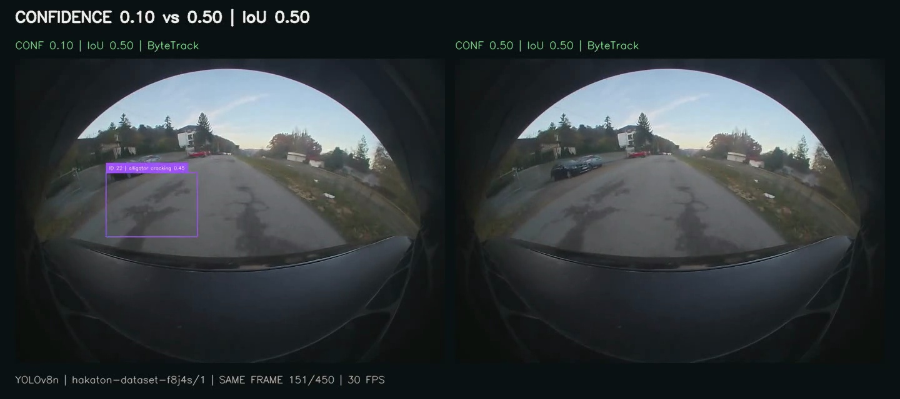
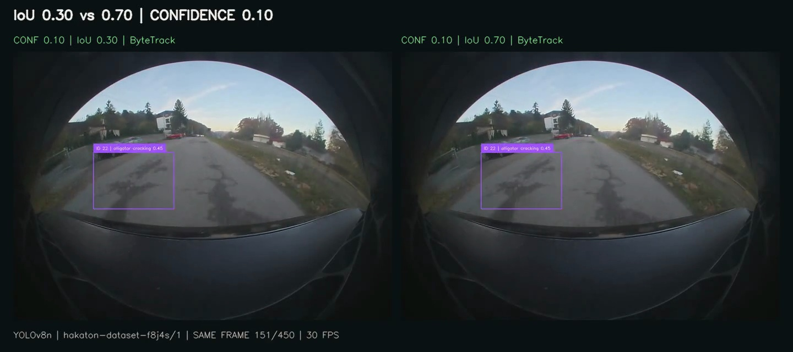

# Side-by-side parameter comparisons

These three videos use the same **02:10–02:25** excerpt from `11_13_25_154945_frontCenter_001.mp4`, the same original team YOLOv8n model (`hakaton-dataset-f8j4s/1`), and all **450 frames at 30 FPS**. Each video synchronizes two parameter variants side by side. The source is the same as the main Rivian demo.

## Confidence 0.10 vs 0.30

[](confidence-10-vs-30.mp4)

[Watch MP4](confidence-10-vs-30.mp4). IoU is fixed at 0.50. This removes more uncertain predictions while retaining some medium-confidence detections.

## Confidence 0.10 vs 0.50

[](confidence-10-vs-50.mp4)

[Watch MP4](confidence-10-vs-50.mp4). IoU is fixed at 0.50. The stricter panel has substantially fewer labels on this clip; fewer labels alone do not demonstrate better accuracy.

## IoU 0.30 vs 0.70

[](iou-30-vs-70.mp4)

[Watch MP4](iou-30-vs-70.mp4). Confidence is fixed at 0.10. This changes the overlap threshold used by Roboflow's non-maximum suppression, not ByteTrack's matching threshold. A lower IoU value suppresses overlapping detections more aggressively; on this clip the tracked outputs can still look similar.

## Recorded counts

| Variant | Confidence | IoU | Prediction instances across frames | Unique tracker IDs |
| --- | --- | --- | --- | --- |
| conf10 | 0.10 | 0.50 | 428 | 3 |
| conf30 | 0.30 | 0.50 | 81 | 4 |
| conf50 | 0.50 | 0.50 | 8 | 0 |
| iou30 | 0.10 | 0.30 | 390 | 3 |
| iou70 | 0.10 | 0.70 | 493 | 3 |

At confidence 0.50, 8 raw predictions survive but ByteTrack emits no tracked boxes on this excerpt. IoU 0.30 and 0.70 yield 390 and 493 raw prediction instances respectively, while both finish with 3 tracker IDs; most of their visible tracked output is similar.

Prediction instances include repeated observations across frames. Unique tracker IDs are not verified unique road defects, and tracker IDs in different panels are independent. Final classes per track and exact settings are in [results.json](results.json).

## Method and limitations

Actual Roboflow API predictions are queried separately at IoU 0.30, 0.50 and 0.70 with confidence 0.10. Confidence variants filter these cached post-NMS predictions at 0.10, 0.30 and 0.50 before replaying the application's real `VideoProcessor.process_frame` annotation/tracking code. Every variant starts a fresh default Supervision ByteTrack tracker (activation threshold 0.25, matching threshold 0.80, lost-track buffer 30 frames at 30 FPS). The tracker therefore also affects which low-confidence detections become visible.

The comparison runner does not use the upload endpoint, write GPS records or persist to the database. The main demo covers that end-to-end path. The runner uses `(0, 0)` only as an unused position argument to the in-memory annotation routine; no synthetic GPS data is saved or published. Frames are JPEG encoded for caching/transport, consistently across all variants. Panels are resized only for the final 1440 × 640 presentation.

No boxes were drawn manually, no alternate model was substituted and no confidence scores were fabricated. These videos are qualitative comparisons, with possible false positives, missed damage and tracking fragmentation. There is no labeled ground truth here, so these counts cannot establish which configuration is most accurate.

## Reproduce

From the repository root, using the same 15-second source excerpt:

```bash
pip install -r requirements-hosted.txt
export ROBOFLOW_API_KEY=your_key
python scripts/compare_parameters.py \
  --video /path/to/rivian-demo-input.mp4 \
  --cache /path/to/private-comparison-cache \
  --output demo/parameters
```

The first run sends up to 1,350 frames to Roboflow (450 per IoU setting) and consumes inference credits. Cached reruns reuse the API responses. Keep the key and cache outside Git. The script records the source SHA-256 digest so the exact input can be checked. API application defaults remain confidence 0.10 and IoU 0.50.
